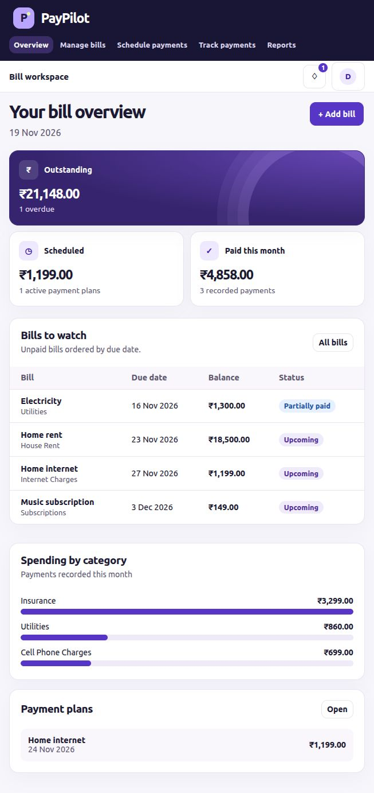

# PayPilot

PayPilot is a mobile-friendly bill management app that brings due dates, balances, reminders, and payment history into one workspace. The portfolio demo uses sample bills and runs locally without payment or SMS provider accounts.

[Quick start](#quick-start) · [Demo walkthrough](#demo-walkthrough) · [Architecture](#architecture) · [Tests](#tests)



## Features

| Area | What you can do |
| --- | --- |
| Bills | Create, edit, and archive bills. Set priorities, attach PDFs, create recurring bills, and filter by category, status, or due date. |
| Payments | Record external and partial payments. Schedule, reschedule, and cancel test payments. Review balances, history, and test receipts. |
| Reminders | Configure per-bill reminders, snooze them, and view SMS previews in the notification inbox. |
| Reports | Review monthly payments, spending by category, and upcoming or overdue balances. |
| Access and audit | Request account access, verify sign-in with a one-time code, set an optional PIN, and review account and transaction events as an administrator. |

## Quick start

**Prerequisites:** Java 17 or later and Maven 3.6.3 or later.

From the repository root, build and start the app.

```sh
mvn verify
java -jar target/paypilot-1.0.0.jar
```

Open [PayPilot on port 8001](http://127.0.0.1:8001/) and select **Open sample workspace**. The app listens on loopback and stores Java demo data in `.paypilot-java/`.

## Demo walkthrough

1. Open **Notifications → View SMS** to preview the seeded rent reminder.
2. Under **Manage bills**, select **Electricity**, choose **Pay now · Simulate**, and set the test result to **Decline**. The ₹1,300 balance stays outstanding.
3. Repeat with **Approve**. The bill is marked paid. In **Track payments → Test transactions**, compare the references and outcomes for both attempts.
4. In **Schedule payments**, pick another unpaid bill. Choose today to demonstrate simulated settlement, or choose a future date to try rescheduling and cancellation.
5. Open **Reports** to see how the settlement changes recorded spending.

## Architecture

| Layer | Technology |
| --- | --- |
| Frontend | Responsive HTML, CSS, and JavaScript |
| Web and services | Java 17 and Spring Boot |
| Persistence | Spring Data JPA support and Hibernate ORM |
| Local database | H2 in file mode |
| Optional database profile | Oracle JDBC for Oracle 19c+ |

Spring Boot serves the frontend and JSON API from the same origin. Services handle access approval, billing, reminders, and the payment ledger. Hibernate maps those records to relational tables. A background worker processes due schedules and reminders once per minute while the app is running.

```text
static/                    Browser UI
src/main/java/dev/paypilot  API, services, and JPA entities
src/main/resources         Local and Oracle configuration
src/test/java/dev/paypilot  Java integration tests
paypilot.py                Original Python demo
tests/                     Python regression tests
```

## Tests

```sh
mvn test
```

The Java integration tests cover access approval, lockout and recovery, PDF attachments, recurring bills, reminder deduplication, account isolation, and simulated settlement. They use an in-memory H2 database and an email stub.

## Configuration

The sample workspace needs no configuration. Set credentials through your environment and use sample account details when testing sign-up.

| Variables | Purpose |
| --- | --- |
| `PAYPILOT_ADMIN_USERNAME`, `PAYPILOT_ADMIN_EMAIL`, `PAYPILOT_ADMIN_PASSWORD` | Create the initial admin at startup. Remove the bootstrap values after creation. |
| `SPRING_MAIL_HOST`, `SPRING_MAIL_PORT`, `SPRING_MAIL_USERNAME`, `SPRING_MAIL_PASSWORD`, `PAYPILOT_MAIL_FROM` | Enable email OTP and reminders for registered test accounts. In an unconfigured local demo, OTPs appear in the server terminal. Set TLS and authentication to match the SMTP service. |
| `PAYPILOT_MAINTENANCE_NOTICE` | Show a scheduled maintenance message on the sign-in page and dashboard. |
| `PAYPILOT_ORACLE_URL`, `PAYPILOT_ORACLE_USER`, `PAYPILOT_ORACLE_PASSWORD` | Supply the database connection when launching with `--spring.profiles.active=oracle`. |

The Oracle profile validates the schema on startup. For an empty development schema, initialize it once with `--spring.jpa.hibernate.ddl-auto=update`, then return to validation. Automated verification uses H2. A live Oracle deployment is pending.

### Backup and restore

Stop the Java app before creating an offline H2 snapshot. Use a fresh filename and retain the encryption key separately.

```sh
java -Dloader.main=org.h2.tools.Backup -cp target/paypilot-1.0.0.jar \
  org.springframework.boot.loader.launch.PropertiesLauncher \
  -dir .paypilot-java -db paypilot -file paypilot-backup.zip
```

Restore into an empty directory using `org.h2.tools.Restore` with the backup file and destination. Place the matching `.paypilot-java/secret.key` beside the restored database, then point the Java datasource and key-file settings at that directory.

<details>
<summary>Original Python demo</summary>

The Python demo uses its own SQLite database under `.paypilot/` and the shared frontend. Run it from the repository root.

```sh
python3 -m pip install -r requirements.txt
python3 paypilot.py serve --demo
```

Open [port 8000](http://127.0.0.1:8000/). Run its tests with `python3 -m unittest discover -s tests`. Use `python3 paypilot.py backup /path/to/new-paypilot-backup.sqlite3` for a database snapshot and retain its matching `.paypilot/secret.key` separately.

</details>

## Portfolio scope

Payment settlement and SMS delivery are simulated and use sample data. The Oracle profile, live provider integrations, multi-device certification, and production capacity targets remain deployment work. See the [business requirements](PayPilot-BRD.md) for the source requirements and implementation status.
